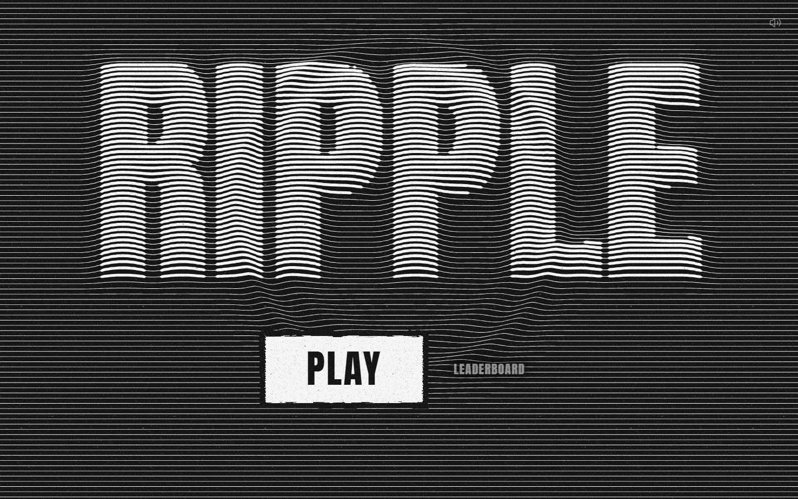
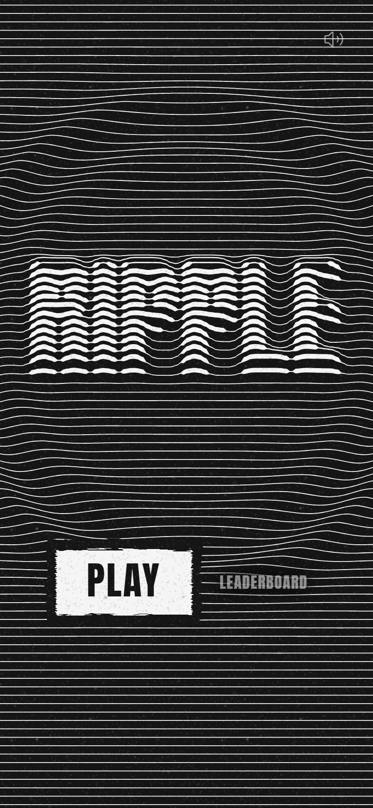
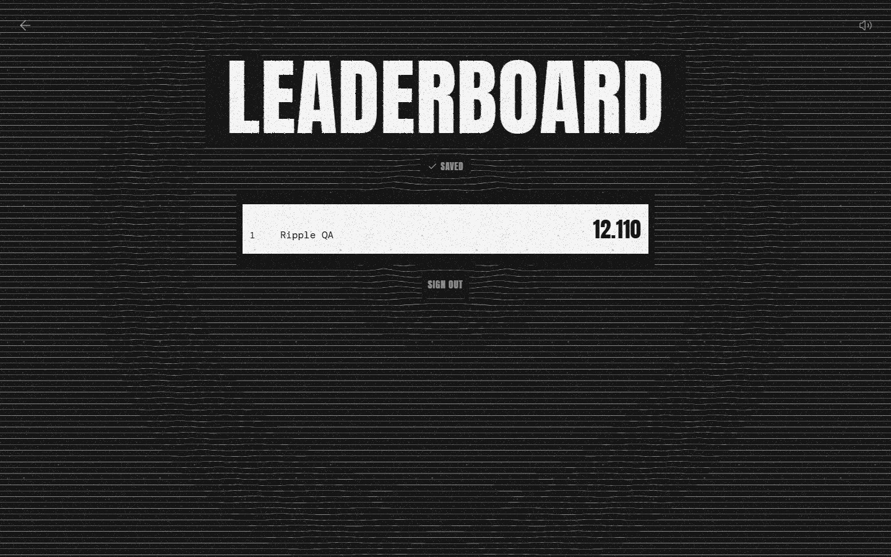
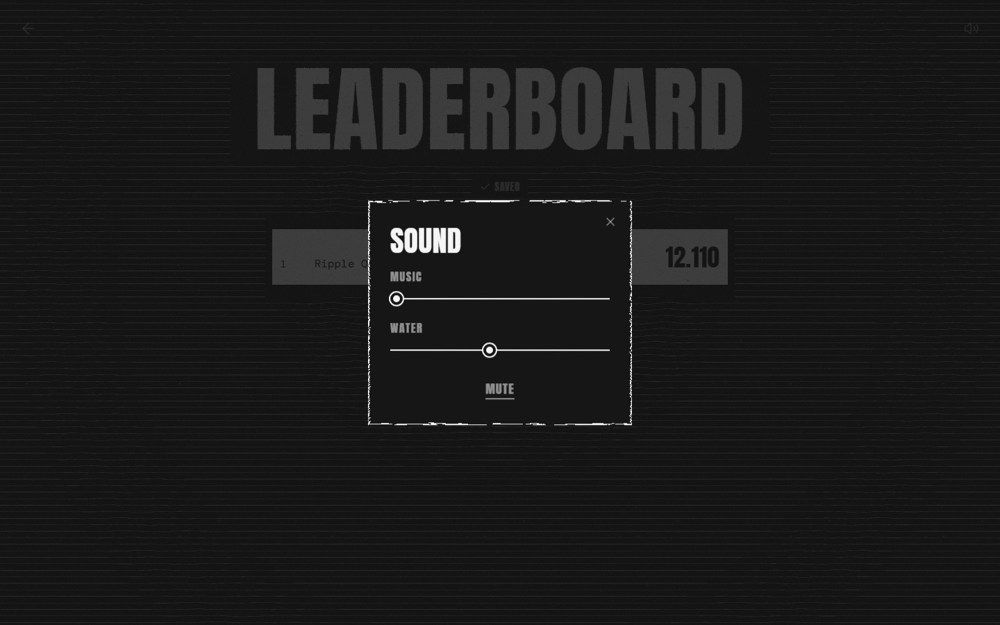

<div align="center">


# ripple

_Every move comes back._

An ink-and-paper survival game about the ripples you leave behind.

[Play Ripple](https://ripple-chi-three.vercel.app) · [How to play](#how-to-play) · [Run locally](#run-locally) · [Deploy](docs/DEPLOYMENT.md) · [Contribute](CONTRIBUTING.md)


</div>



## A small game of cause & effect

One dot. A sheet of dark paper. Every click moves you and leaves a circular wave behind. Those waves bounce off the edges and eventually come back.

Stay ahead of your own decisions.

- **Drawn in ink.** A #151515 field, #f5f5f5 brush rings, and an original menu title embossed into interactive ripple lines. Menu options disappear when you press Play.
- **Reflected waves.** A shared, deterministic simulation powers play and server-side replay validation.
- **A quiet soundtrack.** Three tracks repeat in sequence, with recorded water drops and a calm, low water rumble. Music and effects have separate, persistent volume controls. Music defaults to zero. The new bank has 24 distinct bubble drops, a 12-sample cooldown, and two separate end-of-round plunges.
- **A place for your best.** Play anonymously; sign in to view the live leaderboard and save your best run. A finished run survives login and reloads in the same tab and submits automatically after sign-in.
- **Static frontend.** React, TypeScript, and Canvas on Vercel. Convex runs authentication, replay checks, and persistence.

<details>
<summary>Ripple on a smaller screen</summary>
<br/>

</details>

<details>
<summary>Leaderboard and sound controls</summary>
<br/>

<br/>

</details>

## How to play

1. Choose Play, then click or tap the field to begin.
2. Click somewhere else to move the dot. Every accepted move creates another wave.
3. Waves pulse harmlessly for two seconds, then turn solid and deadly. Avoid armed waves, including reflected waves. Landing directly on a wave also ends your round.
4. Try again. A little longer.

```text
score = clicks × elapsed seconds

12 clicks × 18.425 seconds = 221.100
```

Scores and elapsed time display three decimal places. The first click counts. Movement is instantaneous; only the destination is checked when you move. Clicks less than 80 ms apart are ignored. Waves travel at 36.25 logical units per second and dissipate after 34 seconds, and a round lasts at most three minutes.

| Control                        | Action                                            |
| ------------------------------ | ------------------------------------------------- |
| Click / tap                    | Start or move                                     |
| Arrow keys + `Enter` / `Space` | Aim and move with the keyboard                    |
| `M`                            | Mute / unmute                                     |
| Sound settings                 | Adjust music and water/effects separately         |
| Leaderboard                    | Sign in to see the top 100 and your personal best |

Leaving the browser tab or resizing the playing field ends the current round. Interrupted rounds are not submitted. Sound begins only after an interaction with the page.

## Run locally

Use Node.js **24.x**, npm, and a [Convex](https://www.convex.dev/) account.

```sh
git clone https://github.com/MusicMaster4/Ripple.git
cd Ripple
npm ci
npx convex dev
```

Select your own Convex project. The CLI writes deployment URLs to the ignored `.env.local` file. It also watches and deploys backend changes.

Set the server-only authentication values in that development deployment:

```sh
npx convex env set SITE_URL http://localhost:5173
```

Set `BETTER_AUTH_SECRET` to a cryptographically random secret of at least 32 bytes through the Convex dashboard. Keep it out of shell history, screenshots, and source control. See [deployment instructions](docs/DEPLOYMENT.md) for the complete environment reference.

In another terminal:

```sh
npm run dev
```

Open the local URL shown by Vite. You can play without an account. To use the leaderboard, create an account with a display name, email, password, and password confirmation. The current flow does **not** verify email ownership or send email; do not use it where verified identity is required.

### Useful commands

| Command             | Purpose                                                   |
| ------------------- | --------------------------------------------------------- |
| `npm run dev`       | Start the frontend development server                     |
| `npx convex dev`    | Watch, type-check, and deploy the development backend     |
| `npm run check`     | Type-check the project and run tests                      |
| `npm test`          | Run physics and half-pool cooldown tests                  |
| `npm run secrets`   | Check publishable files for credentials                   |
| `npm run build`     | Type-check and create the static `dist/` bundle           |
| `npm run preview`   | Preview the production frontend build                     |
| `npx convex deploy` | Deploy the backend to the project's production deployment |

`npm ci` applies the committed Convex/Better Auth compatibility patch. Keep installation scripts enabled. See [architecture notes](docs/ARCHITECTURE.md) before upgrading either authentication package.

## Deployment

The web frontend is static and can be hosted entirely on **Vercel**. The leaderboard still requires the external **Convex** service; there is no Vercel server or database to operate.

1. Create a Convex production deployment and configure its private authentication environment.
2. Deploy backend functions with `npx convex deploy`.
3. Import this repository into Vercel using the Vite preset.
4. Add the production `VITE_CONVEX_URL` and `VITE_CONVEX_SITE_URL` variables.
5. Set Convex's `SITE_URL` to the exact public Vercel origin, then deploy the frontend.

The build command is `npm run build`; the output directory is `dist`. Read [the deployment guide](docs/DEPLOYMENT.md) for first-time setup, updates, and production smoke tests.

## Under the surface

```text
Browser · React + Canvas + Web Audio
   │
   ├── deterministic game engine
   ├── local best + sound preferences
   │
   └── Convex
       ├── Better Auth · email/password sessions
       ├── replay validation · authoritative score calculation
       └── live leaderboard · one personal best per player
```

A submitted run contains moves, not a trusted score. The backend replays those moves using the same engine, derives the result, and checks a server-issued run ticket. This rejects invalid movement histories and fabricated score values. It is **not** bot detection or a guarantee against automated play.

Only a display name and score details appear in the authenticated leaderboard. Email addresses, password hashes, and session data are never returned by the leaderboard query. See [architecture and privacy notes](docs/ARCHITECTURE.md) and [security reporting](SECURITY.md).

## Contributing

Bug fixes, thoughtful accessibility improvements, and small changes that preserve the game's quiet character are welcome. Read [CONTRIBUTING.md](CONTRIBUTING.md) before opening a pull request.

Keep the canvas uncluttered. Let the water do most of the talking.

## License

Ripple's original code and documentation are **source-available for noncommercial use** under the [Ripple Noncommercial License](LICENSE). You may study, run, modify, and share them with attribution, but you may not sell, monetize, or use them commercially without separate written permission.

This is not an OSI-approved open-source license. Dependencies, fonts, and supplied audio retain their own rights; the project license does not grant additional rights to third-party material. See [third-party notices](docs/THIRD_PARTY.md) and the [water recording sources](docs/AUDIO_SOURCES.md).
